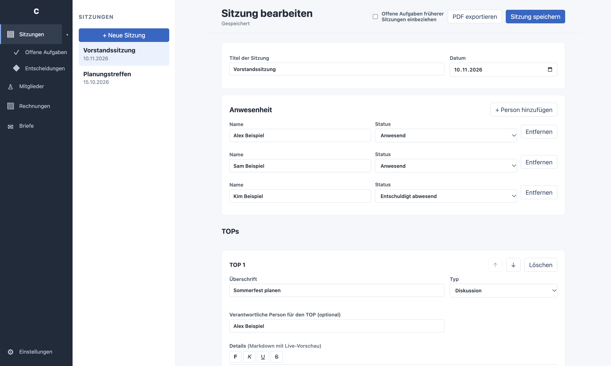
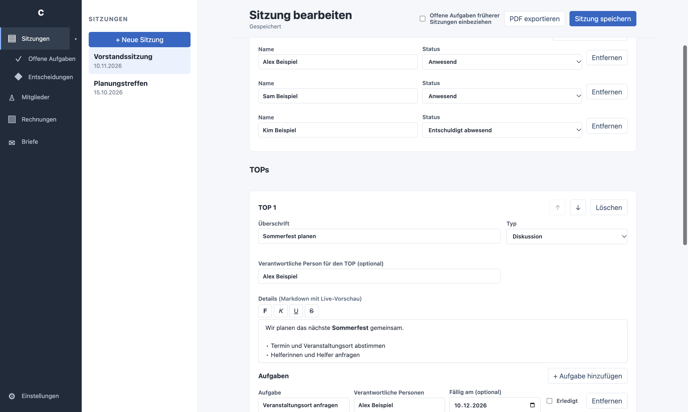
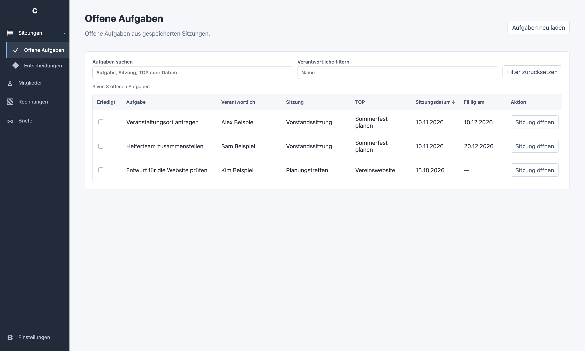
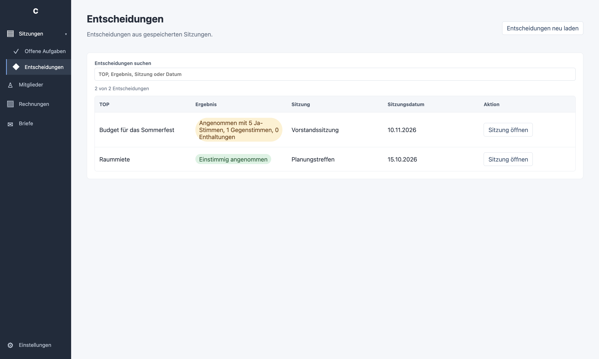
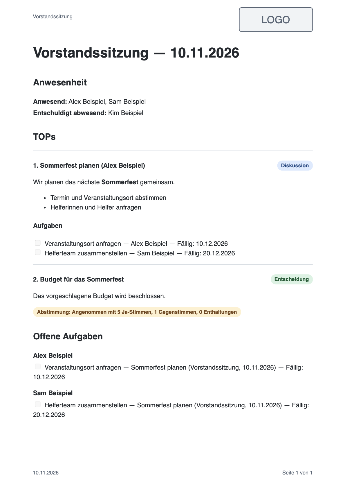

# ClubManager

An early Electron desktop app. The first version focuses on meetings; Members,
Invoices, and Letters are placeholders. See [product ideas](PRODUCT_IDEAS.md)
for the longer-term direction and [architecture](ARCHITECTURE.md) for the
current implementation and maintenance guidance.

## Screenshots

The following screenshots use fictional example data.

### Meetings

Create and edit meetings, attendance and TOPs.



The TOP editor supports Markdown, responsibilities and tasks.



### Open tasks

Review and filter open tasks across saved meetings.



### Decisions

Search decisions and see their recorded results.



### PDF protocol

An example exported protocol using the default PDF stylesheet:



## Run

Install Node.js 22.12 or newer and npm, then:

```sh
npm install
npm start
```

In Settings (the bottom icon), choose a data folder. The app creates `meetings`,
`members`, `invoices`, and `letters` subfolders without moving existing data.
Settings has a tab for each module, where it can be enabled or disabled.
Only Meetings is enabled by default; disabled modules disappear from the sidebar.
The **Allgemein** settings tab shows the running app version in its
**Über ClubManager** section.
Selecting another folder opens that folder's data; it does not migrate it.
In **Einstellungen**, optionally select a CSS file for PDF protocols. It
replaces the default stylesheet, is stored as a path in the app settings, and
is reread for each export. Use **Standardlayout verwenden** to reset it.
If the selected file is missing or unreadable, export reports an error instead
of falling back silently. Use self-contained CSS; external resources are
blocked during PDF generation. Existing PDFs need to be exported again.
The PDF heading combines the meeting title and date. PDF protocols repeat the
meeting title in the page header and the meeting date
and page number in the footer. The header and footer use CSS `@page` margin
boxes; custom stylesheets can change their appearance with `@top-left`,
`@top-right`, `@bottom-left` and `@bottom-right` inside `@page`. The default
stylesheet includes a placeholder logo at the top right. To use your own logo,
embed it as a `data:` image in your custom stylesheet; local file paths and
external image URLs are blocked. Keep suitable page margins to leave room for
the header and footer. The default PDF stylesheet displays each TOP's type
as a colored label beside its heading. Custom stylesheets can style
`.point-heading` and `.type[data-type="discussion"]`, `"decision"`, or
`"info"`; they replace the default CSS rather than extending it.
Individual TOP headings use `h3`, and their task headings use `h4`.
The attendance section groups names by status, with one compact paragraph
per nonempty status.
At the end, the PDF lists open tasks grouped by responsible person. Separate
multiple people with commas or semicolons to list the task under each person;
tasks without a name appear under **Nicht zugewiesen**. Each entry shows its
TOP, meeting and optional deadline. Before exporting, optionally check
**Offene Aufgaben früherer Sitzungen einbeziehen** (off by default). This adds
open tasks from saved meetings with a valid date strictly before the current
meeting; same-day, future and undated meetings are excluded. The current
meeting must have a valid date when this option is enabled. Existing task
lists under each TOP remain unchanged.

Use **Neue Sitzung** to begin, then save. Meeting data is
stored as individual versioned JSON files. Exporting a saved meeting writes its
PDF to `meetings/protocols`, replacing the previous PDF for that meeting. Meeting
TOPs can optionally name a responsible person, independently of task
responsibilities; newly exported PDFs show the name in parentheses after
the TOP heading. Meeting
details support Markdown with an inline live preview. Bold, italic, headings,
inline code, links, lists and task checkboxes are formatted in the editor; their
Markdown markers become visible when the cursor is inside the formatting.
The formatting buttons apply or remove bold, italic, underline and strikethrough
around selected text; without a selection they insert markers for typing.
Underline uses inline `<u>...</u>` HTML because Markdown has no standard
underline syntax. It is rendered in the live preview and exported PDF.
Decision TOPs can record a unanimous or non-unanimous result; for the latter,
yes votes, votes against and abstentions can be entered separately. Results
are included in newly exported PDFs as colored badges: green for unanimous
acceptance, red for unanimous rejection, and yellow for non-unanimous results.
Custom PDF stylesheets can style `.vote-badge`
and its `data-result` attribute. Decision TOPs do not allow new tasks.
Remove existing tasks before switching another TOP to a decision; legacy
decision TOPs with tasks retain them and can still be edited.
Markdown task checkboxes can be toggled directly; these are separate from the
meeting tasks shown in **Offene Aufgaben**. The original Markdown is saved and
used for PDF export, where task checkboxes are shown as non-editable. The Open
Tasks view lists tasks from saved meetings. The sidebar shows names alongside
the module icons. The whole **Sitzungen** row expands or collapses the
**Offene Aufgaben**, **Entscheidungen**, **Alle TOPs** and **Statistiken** subviews and opens the
meeting view when needed.
**Entscheidungen** lists decision TOPs and their results from saved meetings,
including those without a selected result. It can reload the list and open the
source meeting. The search filters TOP titles, results, meeting titles and
dates as you type. Vote counts are shown when recorded.
After export, **Gespeichertes PDF öffnen** opens the last exported protocol in
the system's default PDF viewer. It does not include subsequent meeting changes
until the PDF is exported again. The save and PDF actions remain at the top
while scrolling through a meeting. Save the open meeting with **Ctrl+S** (also
**Cmd+S** on macOS), including while editing Markdown.
In **Offene Aufgaben**, filter the table by text and responsible person, and
click a column heading to change its sort order. Check a task to mark it done
and save immediately. Use **Aufgaben neu laden** to refresh the list, including
after an on-disk conflict. Meeting tasks can have an optional due date; an open
task becomes overdue after that date in the computer's local time zone. The
deadline is also included in newly exported protocols. On narrower windows,
scroll the table horizontally to reach all columns.
Completing a meeting task records the computer's local date; reopening it clears
that date. Newly exported protocols display task checkboxes and, when known,
their completion dates. Previously completed tasks have no inferred date.
**Statistiken** shows current open, completed and overdue task totals and an
estimated trend of open tasks over time. It assumes tasks start on the meeting
date and uses recorded completion dates. Tasks with missing, future, invalid or
inconsistent dates are excluded from the trend but included in current totals.
Creation, deletion and reopening history is not stored, so historical values
are estimates and may change when meeting data changes.

The app warns if a meeting has changed on disk since it was opened. This is not
a synchronization system or a substitute for backups; avoid editing the same
folder with multiple app instances at the same time. Data is not encrypted.

Run the storage tests with `npm test`. With a graphical desktop available, run
the Electron smoke test with `npm run test:electron`.

The interface and generated protocol labels are German. Write new user-facing
text in German, including accessibility labels, dialogs, errors, and document
output. Reuse shared terms from `src/shared/de.js` in the UI and documents.
Existing user-entered content is not translated automatically.

## Debug

In VS Code, choose **Launch Electron main** in Run and Debug and press F5.
VS Code starts Electron and attaches the debugger automatically. Set breakpoints
in the main process, such as `src/main/main.js`; stop debugging to close the
launched app. Install dependencies first with `npm install`. To debug renderer
code, use the Electron window's Developer Tools.
The debug launch builds the Markdown editor automatically. If launching Electron
directly without `npm start`, run `npm run build:editor` first.

Alternatively, run the **Electron: debug main process** task and select
**Attach to Electron main** to attach to that running instance. Its inspector
listens on `127.0.0.1:9231`; stop the task when finished.

## Package the app

On an Apple Silicon Mac, build a DMG containing the app with:

```sh
npm run dist:mac
```

The output is in `dist/`. Without a configured signing identity the local build
is unsigned and not notarized; macOS Gatekeeper may block it or display a
warning. The release workflow below requires signing and notarization.

A Windows x64 NSIS installer target is prepared for a future Windows build:

```sh
npm run dist:win
```

Run this on Windows for the most reliable results. Windows code signing and
Linux packaging are deferred.

## GitHub releases and updates

The **Build and publish release** workflow is started manually from the
repository's **Actions** tab. It builds a macOS Apple Silicon DMG and ZIP and
a Windows x64 NSIS installer, then publishes them together as a GitHub Release.
Both builds and their update metadata must succeed before the release is
published. The workflow uses the commit and `package.json` version of the
selected branch; use a new stable version such as `0.2.0` and update
`package-lock.json` (for example with `npm version 0.2.0 --no-git-tag-version`)
before starting it. It creates tag `v<version>` and refuses to reuse an
existing tag. A failed publishing step can leave a draft release or tag that
must be inspected and resolved before retrying.

Set these repository **Actions secrets** before running the workflow:

| Secret | Value |
| --- | --- |
| `CSC_LINK` | Base64-encoded `.p12` export containing the Developer ID Application certificate **and private key** |
| `CSC_KEY_PASSWORD` | Password for the `.p12` file |
| `APPLE_ID` | Apple account used for notarization |
| `APPLE_APP_SPECIFIC_PASSWORD` | App-specific password for that Apple account |
| `APPLE_TEAM_ID` | Apple Developer team ID |

Use an active Apple Developer Program membership, a Developer ID Application
certificate, and an account authorized for notarization. Generate the base64
value locally with `base64 -i certificate.p12` and add it directly as a GitHub
secret; do not commit credentials. The workflow fails if the signing or
notarization secrets are missing or signing fails. The Windows installer is
currently **unsigned** and may trigger SmartScreen warnings.

Packaged macOS and Windows apps check the public GitHub Releases feed on startup.
An available update downloads in the background and asks before installing and
restarting. If there are unsaved meeting edits, the app asks before discarding
them; declining leaves the meeting open. Choosing **Später** does not install
on exit; the app checks again at the next startup. Update errors are reported
in the app. Updates are disabled when running from source with `npm start`.
The repository and release assets must be public; this workflow does not
configure private-release credentials. macOS automatic updates require the
signed ZIP, so existing unsigned installations must first be replaced manually
with a signed release. Test a release on each target platform before relying on
automatic updates.
